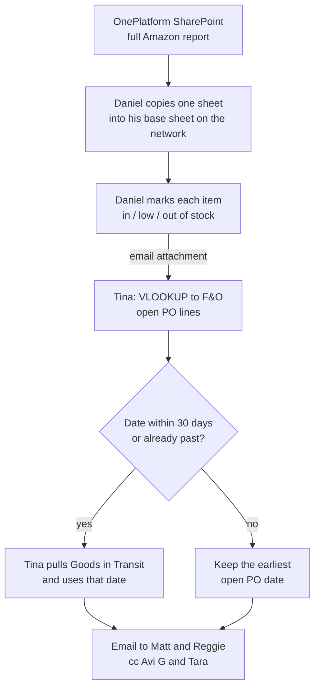

# Weekly Amazon Inventory File for OnePlatform (Vendo)

> **In one line:** every Friday, Daniel and Tina rebuild a spreadsheet telling OnePlatform which Amazon items are in stock, low or out, and when the low and out-of-stock items will be back. Everything in it already lives in F&O.

*Observed Friday, Oct 23, 2026 (Day 7), sitting with Tina. Daniel's part was described by Tina, not watched. OnePlatform was called Vendo when we started working with them.*

---

## At a Glance

| | |
| --- | --- |
| **What** | A weekly status file for every item in our Amazon catalog: in stock, low stock or out of stock, plus the next available date for low and out-of-stock items |
| **Why** | OnePlatform uses it to make advertising decisions on Amazon |
| **When** | Weekly, on Friday |
| **Who** | Daniel (stock status), then Tina (dates and sending) |
| **Sent to** | Matt (OnePlatform) and Reggie (our Amazon rep), cc Avi G and Tara (OnePlatform) |
| **Volume** | The whole Amazon catalog, every week |
| **Time** | Tina: under 10 minutes, depending on interruptions. Daniel: not known |
| **Systems** | OnePlatform SharePoint, network drive, F&O (available quantity, open PO lines, Goods in Transit), Excel VLOOKUPs, email |

---

## The Flow

---

## Step by Step

| # | Who | Step | Where |
| --- | --- | --- | --- |
| 1 | Daniel | Downloads OnePlatform's Excel, a running report of everything we do with Amazon, with the full product list | OnePlatform SharePoint |
| 2 | Daniel | Copies one sheet into his base sheet and starts the week's file from scratch | Network drive |
| 3 | Daniel | Marks every item in, low or out of stock from the F&O quantity | Excel, F&O |
| 4 | Daniel | Emails the file to Tina as an attachment | Email |
| 5 | Tina | Downloads open PO lines and VLOOKUPs the low and out-of-stock items to them, taking the **earliest** open PO date | F&O, Excel |
| 6 | Tina | For dates within 30 days of today, or already past, pulls Goods in Transit and uses its date instead | F&O, Excel |
| 7 | Tina | Leaves the date blank when there's no open PO and nothing in transit | Excel |
| 8 | Tina | Emails the file to Matt and Reggie, cc Avi G and Tara | Email |

Daniel can't do steps 5 to 7 because he has no access to open PO lines or Goods in Transit.

---

## The Rules

### Stock levels

We don't send Amazon exact quantities because the warehouse is too fluid. Status is based on **pieces** of available quantity in **warehouse 1600** (our only warehouse).

| Status | Pieces | Why |
| --- | --- | --- |
| Out of stock | 11 or fewer | Amazon requires full packs, and 12 is the most common pack size |
| Low stock | 12 to 49 | Under 50 is an arbitrary cutoff |
| In stock | 50 or more | |

### Next available date

| Source | When it's set | Notes |
| --- | --- | --- |
| Open PO line | When the PO is created | Covers items not yet shipped, but often out of date |
| Goods in Transit | When the goods ship, and updated as things change | More accurate, but only exists once the goods are on the water |

The two have to be combined: Goods in Transit alone would leave out everything not yet shipped. A past date usually means the warehouse has already received the goods. The 30-day cutoff comes from Avi Altman's explanation of how he updates dates in the system.

### Black and red items

- **Black:** items we keep selling. This is most of the work.
- **Red:** discontinued or obsolete. They stay on the file so Amazon can sell its own remaining stock and OnePlatform still gets information on them. Once a red item's Amazon inventory reaches 0, it's dead.
- Reds are updated from F&O status: discontinued with stock left stays **disco**; discontinued with no stock becomes **obsolete**.

### What we send

ASIN, SKU, UPC, product name and inventory status, for the whole list every week, not only items that changed. OnePlatform's file also has Amazon's product line, subcategory and similar fields, but we don't need to send those. **Everything we send is already in F&O.**

---

## Why It Works This Way

| Question | Answer |
| --- | --- |
| Why start from scratch every week? | By design. A full download plus a lookup is easier than finding only the items whose status changed |
| Why send the whole list and not just changes? | It's needed every week |
| Why does Tina do the dates and not Daniel? | Daniel has no access to open PO lines or Goods in Transit |
| Why the earliest open PO date? | It's the next stock to arrive |
| Why the 30-day cutoff? | It follows how Avi Altman updates dates in the system |
| Is anything on OnePlatform's file missing from F&O? | Only Amazon's product line and subcategory, which we don't send |

---

## Pain Points

- **Two people, two hand-offs, one email attachment.** The file moves Daniel → Tina → OnePlatform by email instead of living in one shared place.
- **Rebuilt every week** from a fresh download, even though the inputs are all in F&O.
- **Manual VLOOKUPs across three exports** (OnePlatform file, open PO lines, Goods in Transit).
- **Out-of-stock items aren't marked temporarily unavailable** on Amazon with an in-stock date. Tina is fairly sure OnePlatform doesn't do it for us, and we don't either.
- **Key-person risk:** Daniel's part isn't timed or documented, and Tina says he may be leaving.

---

## My Ideas

1. **Start with an F&O report that has the dates already combined.** Even if we don't change the rest of the flow, one report with every item's next date is a good starting point and an easy build.
2. **Build the whole file for her.** Everything we send (ASIN, SKU, UPC, product name, status) is already in F&O, so the entire weekly file can be generated every week.
3. **Drop the 30-day rule.** Take Goods in Transit dates first, then look up open POs only for items still without a date. I've already recommended this to Tina.
4. **One shared file, updated every week,** not an attachment emailed back and forth and started from scratch.
5. **Make the low-stock cutoff a multiple of 12,** like 48 or 60, to match the pack size. Not changing it now; I'm not reinventing her wheel.
6. **Mark out-of-stock items temporarily unavailable with an in-stock date.** Decide whether OnePlatform or we own it.
7. **Communication note:** Tina uses Teams well but also a lot of email, which supports the case for one central channel.

---

## The Bot: Weekly Amazon Inventory File (Bot C)

| | |
| --- | --- |
| **Trigger** | Weekly, on Friday |
| **What it does** | Builds the whole file from F&O: ASIN, SKU, UPC, product name and status for every item in the Amazon catalog. Status comes from available quantity in warehouse 1600 (11 or fewer out, under 50 low, 50 or more in). For low and out-of-stock items it adds the next available date: the Goods in Transit date where there is one, otherwise the earliest open PO date, blank if neither. No 30-day cutoff. Marks discontinued items disco while we have stock and obsolete once we don't. Drafts the email to Matt and Reggie, cc Avi G and Tara |
| **Data** | F&O items (ASIN, SKU, UPC, name, status), available quantity for 1600, open PO lines, Goods in Transit; OnePlatform's file only as a cross-check |
| **First step** | An F&O report with the dates already combined |
| **Human check** | Tina reviews the file and sends the email |
| **Replaces** | Daniel's weekly rebuild and status marking, Tina's VLOOKUPs, and the email hand-off between them |
| **Later** | Flag out-of-stock items to mark temporarily unavailable on Amazon, once an owner is agreed |

---

*Sources: Day 7 in [raw_notes.md](../raw_notes.md) and [shadowing_notes.md](../shadowing_notes.md); Part 13 and Bot C in the [v2 report](../Shadowing_Report_2026-10-22_v2.md). Day 2 (Part 4, episode 5) has the first, partial view of this process.*
