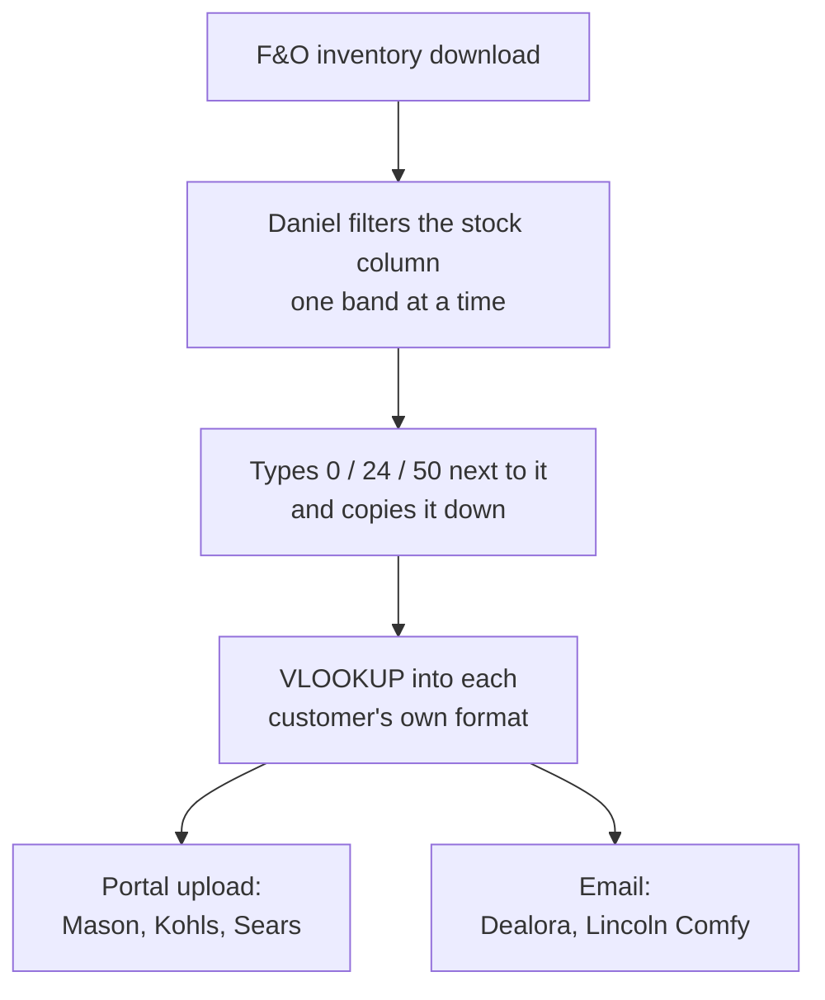
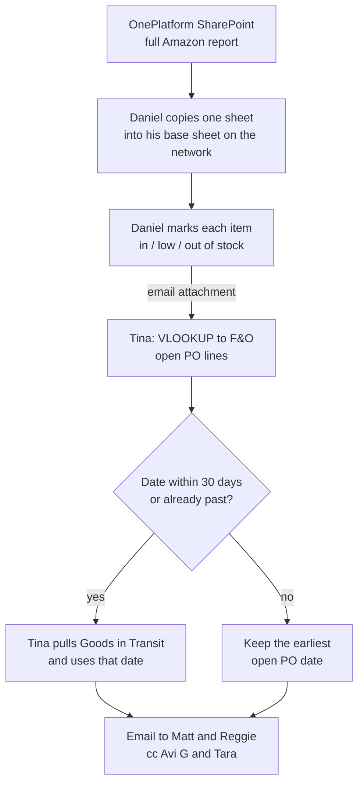

# Customer Inventory Feeds (Amazon weekly, 5 customers daily)

> **In one line:** Daniel hand-filters an F&O inventory download into six customer feeds: a weekly in / low / out file for Amazon (which Tina finishes with next available dates for OnePlatform), and a daily 0 / 24 / 50 quantity file for Mason, Dealora, Kohls, Lincoln Comfy and Sears. Everything in them already lives in F&O.

*Amazon: observed Friday, Oct 23, 2026 (Day 7), sitting with Tina; Daniel's part described by Tina. Daily feeds: from a follow-up conversation with Daniel, not watched. OnePlatform was called Vendo when we started working with them.*

---

## At a Glance

| | |
| --- | --- |
| **What** | Inventory feeds telling six customers what we can ship: no exact quantities, just a stock band per item |
| **Scope** | Only the 5 customers Daniel builds by hand daily, plus Amazon weekly. All other customers get inventory automatically by EDI 846 or a standard emailed file |
| **Why** | Amazon: OnePlatform uses it to make advertising decisions for Amazon warehouse (Daniel didn't know what it was for). Daily customers: not asked (presumably so their sites don't sell what we can't ship). Kohls is also where leftover disco'd stock gets sold off |
| **When** | Amazon weekly, on Friday. The other five daily |
| **Who** | Daniel builds all six. Tina adds dates to Amazon's and sends it |
| **Volume** | Amazon: OnePlatform's whole catalog (the entire Amazon catalog), every week. Daily: each customer's full item list |
| **Time** | Daily feeds: about 10 to 15 minutes a day for all five (roughly 1 to 1.25 hours a week). Amazon: Tina under 10 minutes; Daniel's part not timed |
| **Systems** | F&O (inventory, open PO lines, Goods in Transit), Excel filters and VLOOKUPs, the server (Daniel's templates), OneDrive, OnePlatform SharePoint, customer portals, email |

### The six feeds

| Customer | How often | What they get | Extra fields | How it's sent |
| --- | --- | --- | --- | --- |
| Amazon (via OnePlatform) | Weekly, Friday | In stock, low stock or out of stock, plus next available date | ASIN, SKU, UPC, product name | Tina emails Matt and Reggie, cc Avi G and Tara; Daniel also saves it in OneDrive |
| Mason | Daily | 0, 24 or 50 | Own format | Portal upload |
| Dealora | Daily | 0, 24 or 50 | Own format | Email |
| Kohls | Daily | 0, 24 or 50, plus 1 to 5 on disco'd items we still have | Own format | Portal upload (DSCO) |
| Lincoln Comfy | Daily | 0, 24 or 50 | Image URL | Email |
| Sears | Daily | 0, 24 or 50 | Variation group ID | Portal upload |

---

## The Flow

### Daily feeds

### Amazon, weekly (as it runs today)

---

## Step by Step

| # | Who | Step | Where |
| --- | --- | --- | --- |
| 1 | Daniel | Downloads OnePlatform's Excel, a running report of everything we do with Amazon, with the full product list | OnePlatform SharePoint |
| 2 | Daniel | Copies one sheet into his template and starts the week's file from scratch | Server |
| 3 | Daniel | Downloads inventory from F&O. Filters the stock column for one band, types in / low / out in the next column, copies it down, then filters the next band | F&O, Excel |
| 4 | Daniel | VLOOKUPs the statuses from his working inventory file into the Amazon file | Excel |
| 5 | Daniel | Saves it in OneDrive and emails it to Tina as an attachment | OneDrive, email |
| 6 | Tina | Downloads open PO lines and VLOOKUPs the low and out-of-stock items to them, taking the **earliest** open PO date | F&O, Excel |
| 7 | Tina | For dates within 30 days of today, or already past, pulls Goods in Transit and uses its date instead | F&O, Excel |
| 8 | Tina | Leaves the date blank when there's no open PO and nothing in transit | Excel |
| 9 | Tina | Emails the file to Matt and Reggie, cc Avi G and Tara | Email |

Daniel can't do steps 6 to 8 because he has no access to open PO lines or Goods in Transit.

### Daily feeds (Daniel)

| # | Step | Where |
| --- | --- | --- |
| 1 | Downloads inventory from F&O | F&O |
| 2 | Filters the stock column one band at a time and types 0, 24 or 50 next to it, copying it down | Excel |
| 3 | VLOOKUPs into each customer's template, each in its own format | Excel, server |
| 4 | Uploads Mason, Kohls and Sears to their portals; emails Dealora and Lincoln Comfy | Portals, email |

---

## The Rules

### Stock levels

We don't send exact quantities because the warehouse is too fluid. Status is based on **pieces** in **warehouse 1600** (our only warehouse). Tina uses available quantity.

| Status | Pieces | Daily customers get |
| --- | --- | --- |
| Out of stock | Under 24 | 0 |
| Low stock | 24 to 50 | 24 |
| In stock | Above 50 | 50 |

Tina first described 11 or fewer as out of stock (Amazon requires full packs, and 12 is the most common pack size). Daniel uses 24, and Tina confirmed that's fine: any cutoff above the pack size works.

> **The one rule that matters:** never send a customer more than we have. As long as out-of-stock items go out as out of stock and every number we send is at or below what's really there (we have 30, we send 24), we're fine. That's why Daniel's 24 and Tina's 12 are both OK.

### Kohls: the sell-off channel for disco'd stock

These five are the only customers whose feeds Daniel builds by hand every day. All our other customers (and there are many more) get inventory automatically, either by EDI (an 846) or by an automatic email with a standard inventory file. Those automated feeds zero an item once it gets to 6, so no automated customer gets inventory for a disco'd item with less than 6. Kohls is manual, so Tina uses it to sell off leftovers: when we have disco'd items in stock (from returns, or never sold off), she puts in a small number here and there: 1, 2, 3, 4 or 5, depending on what we have. This is the reason behind Day 2's "under 5, send 0" note.

- **Why Kohls:** of the five daily feeds, Kohls carries the largest catalog of our items, so it's most likely to list the leftover item.
- **How to find them:** F&O already flags items that are disco'd, and the on-hand sheet shows which of those still have stock. Checking the two together gives the sell-off list.
- **Never drop the line:** disco'd items stay on the file at 0 rather than being left off. Daniel already does this; he sends Tina the list with them still on it.

### Next available date

Only the Amazon file gets dates today. Mason and Kohls would like to receive future dates too, but we don't add them yet; Tina says any automation we build should. They need two fields: the **next receive date** and the **next available quantity**. The quantity is always 24, as long as the next PO has more than 24.

| Source | When it's set | Notes |
| --- | --- | --- |
| Open PO line | When the PO is created | Covers items not yet shipped, but often out of date |
| Goods in Transit | When the goods ship, and updated as things change | More accurate, but only exists once the goods are on the water |

The two have to be combined: Goods in Transit alone would leave out everything not yet shipped. A past date usually means the warehouse has already received the goods. The 30-day cutoff comes from Avi Altman's explanation of how he updates dates in the system.

### Black and red items

- **Black:** items we keep selling. This is most of the work.
- **Red:** discontinued or obsolete. They stay on the file so Amazon can sell its own remaining stock and OnePlatform still gets information on them. Once a red item's Amazon inventory reaches 0, it's dead.
- A red is only updated when the item becomes **obsolete** in F&O (disco'd with no stock left). Amazon may still have inventory of it in its DCs, so it stays on the file.

### What we need to send (Amazon)

ASIN, SKU, UPC, product name and inventory status, for every item in OnePlatform's catalog (the entire Amazon catalog) every week, not only items that changed. OnePlatform's file and the current file we use also has Amazon's product line, subcategory and similar fields, but we don't *need* to send those. **Everything we send is already in F&O.** The item list itself is our Amazon catalog in F&O, which is the same as OnePlatform's. Daniel only re-uses OnePlatform's reporting sheet as his starting file.

---

## Why It Works This Way

| Question | Answer |
| --- | --- |
| Why start from scratch every week? | By design. A full download plus a lookup is easier than finding only the items whose status changed |
| Why send the whole list and not just changes? | It's needed every week |
| Why does Tina do the dates and not Daniel? | Daniel has no access to open PO lines or Goods in Transit |
| Why the earliest open PO date? | It's the next stock to arrive |
| Why the 30-day cutoff? | It follows how Avi Altman updates dates in the system |
| Is anything on OnePlatform's file missing from F&O? | Only Amazon's product line and subcategory, which we don't send |
| Why numbers for the daily customers? | They take a quantity, not a status, so the bands become 0, 24 and 50 |
| Why are these five built by hand? | They don't have EDI capability for inventory; not every customer takes an 846 |
| Why six different files? | Each customer has its own format and its own way of receiving it (portal or email) |

---

## Pain Points

- **Six hand-filtered feeds.** The same F&O download is filtered band by band and typed in by hand, every day, then VLOOKUPed into six different formats.
- **The rules live in people's heads.** Tina described 12, Daniel uses 24, and Kohls has its own disco sell-off habit. The different cutoffs turned out to be fine (the only real rule is never sending more than we have), but nothing was written down.
- **Disco sell-off is ad hoc.** Tina adds 1 to 5 on Kohls "here and there" when she knows of leftover disco'd stock. The F&O disco flag and the on-hand sheet could be checked together to find them all, but nobody does that systematically.
- **Mason and Kohls want dates we don't send.** They'd like future dates; only Amazon gets them today, because adding them by hand is Tina's extra step.
- **Daniel doesn't know what the Amazon file is for,** and thought it was dropship only. He runs it the same way as the others.
- **Unclear extra fields.** Lincoln Comfy's image URL may not be needed or may not be in F&O; Sears' variation group ID isn't understood yet.
- **Two people, two hand-offs, one email attachment** (Amazon). The file moves Daniel → Tina → OnePlatform by email instead of living in one shared place.
- **Rebuilt every week** from a fresh download, even though the inputs are all in F&O.
- **Manual VLOOKUPs across three exports** (OnePlatform file, open PO lines, Goods in Transit).
- **Out-of-stock items aren't marked temporarily unavailable** on Amazon with an in-stock date. Tina is fairly sure OnePlatform doesn't do it for us, and we don't either.
- **Key-person risk:** all six feeds sit with Daniel, his Amazon part isn't timed, nothing is documented, and Tina says he may be leaving.

---

## My Ideas

1. **Start with an F&O report that has the dates already combined.** Even if we don't change the rest of the flow, one report with every item's next date is a good starting point and an easy build.
2. **Build the whole file for her.** Everything we send (ASIN, SKU, UPC, product name, status) is already in F&O, so the entire weekly file can be generated every week.
3. **Drop the 30-day rule.** Take Goods in Transit dates first, then look up open POs only for items still without a date. I've already recommended this to Tina.
4. **One shared file, updated every week,** not an attachment emailed back and forth and started from scratch.
5. **Make the low-stock cutoff a multiple of 12,** like 48 or 60, to match the pack size. Not changing it now; I'm not reinventing her wheel.
6. **Mark out-of-stock items temporarily unavailable with an in-stock date.** Decide whether OnePlatform or we own it.
7. **One inventory pull, six outputs.** The daily feeds are the same bands in different layouts, so one F&O pull can feed all of them, not just Amazon.
8. **Write the rules down** (under 24 out, 24 to 50 low, above 50 in) and keep them in the bot instead of in Daniel's head.
9. **One job, different schedules.** For a bot or report runner, Amazon and the daily feeds are the same thing: same pull, same bands, a different format and schedule per customer.
10. **Automate the disco sell-off.** Check the F&O disco flag against on-hand every day and propose the Kohls sell-off quantity (1 to 5, never more than we have) automatically, instead of Tina remembering them.
11. **Pick the sell-off channel by margin, not catalog size.** Kohls is used today because it has the biggest catalog of our items; it may make more sense to sell leftovers wherever our pricing is best.
12. **Add future dates to Mason and Kohls.** They've asked for the next receive date and next available quantity (24, as long as the next PO has more than 24); once the dates come from one F&O report, adding them to any feed is free. Tina wants this in any automation we build.
13. **Check Lincoln Comfy's image URL and Sears' variation group ID** before building: whether they're needed and whether F&O has them.
14. **Communication note:** Tina uses Teams well but also a lot of email, which supports the case for one central channel.

---

## The Bot: Customer Inventory Feeds (Bot C)

| | |
| --- | --- |
| **Trigger** | Daily for Mason, Dealora, Kohls, Lincoln Comfy and Sears; weekly on Friday for Amazon |
| **What it does** | Pulls inventory for warehouse 1600 from F&O once and builds every feed in its customer's format, using one set of cutoffs (under 24 out, 24 to 50 low, above that in), each on its own schedule. Daily customers get 0, 24 or 50. For Kohls it also checks the F&O disco flag against on-hand and adds 1 to 5 (never more than we have) on each disco'd item we still have (Tina approves), keeping zeroed lines on the file, so leftovers sell off there. It never sends more than we have; it uploads Mason, Kohls and Sears to their portals (or queues them for upload) and drafts the Dealora and Lincoln Comfy emails. For Amazon it builds the whole file: ASIN, SKU, UPC, product name and in / low / out for every item in OnePlatform's catalog, plus the next available date for low and out-of-stock items (the Goods in Transit date where there is one, otherwise the earliest open PO date, blank if neither; no 30-day cutoff). Marks discontinued items disco while we have stock and obsolete once we don't. Adds the next receive date and next available quantity (24 when the next PO has more than 24) to the Mason and Kohls feeds, which they'd like but don't get today. Saves to OneDrive and drafts the email to Matt and Reggie, cc Avi G and Tara |
| **Data** | F&O items (ASIN, SKU, UPC, name, status), available quantity for 1600, open PO lines, Goods in Transit; each customer's template; Lincoln Comfy image URLs and Sears variation group IDs if needed; OnePlatform's file only as a cross-check |
| **First step** | An F&O report with the stock band and the next available date already worked out for every item |
| **Human check** | Daniel (or whoever takes over) glances at the daily files before upload; Tina reviews the Amazon file and sends the email |
| **Replaces** | Daniel's daily band-by-band filtering and six VLOOKUPs, his weekly Amazon rebuild, Tina's date VLOOKUPs, and the email hand-off between them. About 1 to 1.25 hours a week of daily feeds plus the Amazon file |
| **Later** | Flag out-of-stock Amazon items to mark temporarily unavailable, once an owner is agreed |

---

*Sources: Day 7 and the follow-up with Daniel in [raw_notes.md](../raw_notes.md) and [shadowing_notes.md](../shadowing_notes.md); Part 13 and Bot C in the [v2 report](../Shadowing_Report_2026-10-22_v2.md). Day 2 (Part 4, episodes 1 and 5) has the first, partial view of the Kohls and Amazon feeds.*
