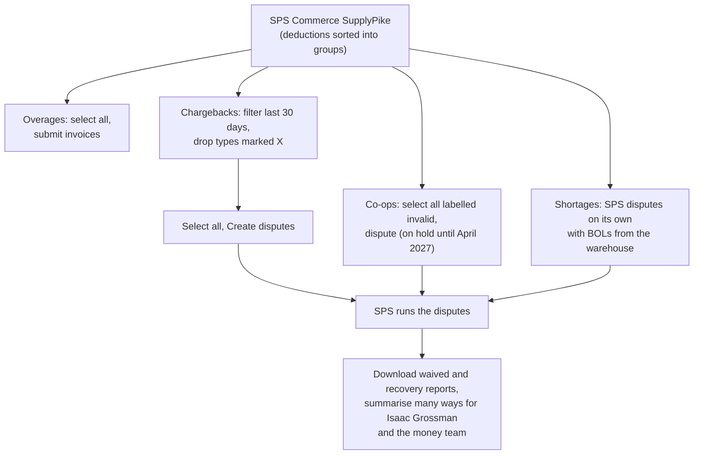
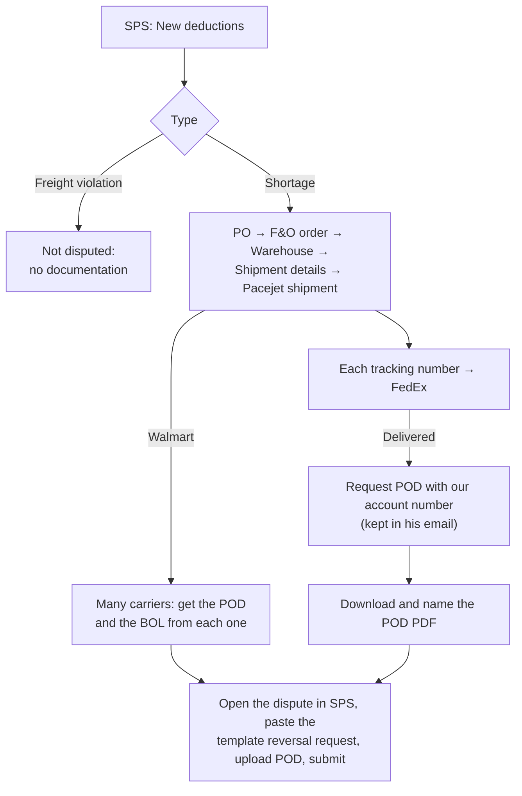

# Deductions and Disputes

> **In one line:** when a customer takes money off a payment, someone decides whether to accept or dispute it. Charmaine does it by hand for the dropship customers (Wayfair portal and email). Baruch Salamander does it in SPS Commerce SupplyPike for Amazon, Lowes, Home Depot and Walmart, where most of it is one click and SPS runs the dispute. The exception is shortage proof for Lowes, Home Depot and Walmart, which he digs out of F&O and FedEx one tracking number at a time.

*Charmaine: from a conversation after Day 7, not watched, plus Day 2 (Part 7), where she was seen working Wayfair deductions. Baruch Salamander: Day 8 (Oct 27), a walkthrough he gave on request, plus Day 5 (Part 11). Tina: backstory on why we use SPS Commerce, after Baruch Salamander on Oct 27. Still to add: Suzanne's short pays, the Amazon dispute list from Avi G, and the technical side of our SPS Commerce connection (not Tina's to answer; who to ask is open).*

---

## At a Glance

| | |
| --- | --- |
| **What** | Accepting or disputing what customers take off their payments (deductions, chargebacks, co-ops, shortages, overages), and making sure the remittance is posted the right way |
| **Why** | To get back money that customers take wrongly, and accept what our agreements allow |
| **Who** | **Charmaine:** DS customers. **Baruch Salamander:** Amazon, Lowes, Home Depot and Walmart in SPS Commerce. Tina and Avi set Charmaine's rules. Suzanne checks the amounts when she posts the payment |
| **When** | Both daily. Wayfair before each settlement date; Amazon chargebacks within 30 days; UnbeatableSales sends a weekly batch |
| **Volume** | Charmaine: 70 deductions in Oct 2 to 15, 11 needing a check. Baruch Salamander: no counts given. Amazon last year: chargebacks $540k and shortages $917k charged |
| **Money back (Amazon, last year)** | Chargebacks $127k (24%), shortages $191k (21%), co-ops $146k. About **$464k** in all |
| **Time** | Charmaine: 5 to 15 minutes per check. Baruch Salamander: not timed; the shortage proof chain is several screens per tracking number |
| **Systems** | SPS Commerce SupplyPike, Wayfair and other portals, Outlook, F&O (sales order, Pacejet shipment), FedEx (tracking, proof of delivery), Amazon Vendor Central, customer images, warehouse returns |

### Who handles which customer

| Customer | Who | Where | Notes |
| --- | --- | --- | --- |
| Amazon | Baruch Salamander | SPS Commerce SupplyPike | Mostly one-click; SPS handles shortages on its own with BOLs from the warehouse |
| Lowes | Baruch Salamander | SPS Commerce (all connections, DS included) | Shortages disputed with a FedEx POD; freight violations never disputed. Charmaine's Lowes work is manual 810 invoices for missed cancellations (Day 1), not deductions |
| Home Depot | Baruch Salamander | SPS Commerce | Same as Lowes |
| Walmart | Baruch Salamander | SPS Commerce | Like Lowes, but harder: many carriers, and he needs both the POD and the BOL from each |
| Wayfair | Charmaine | Portal, daily | Managed returns always accepted; disputes on a ticket; settlement-date deadline |
| OJCommerce and a few others | Charmaine | Not stated | DS |
| VirVentures, UnbeatableSales, KartIt | Charmaine | Email | Fully manual; Unbeatable sends a weekly batch |

### Amazon, last year (Baruch Salamander's figures)

| Group | Charged | Recovered | Who disputes |
| --- | --- | --- | --- |
| Chargebacks | $540k | $127k | Baruch Salamander clicks the disputable ones; SPS disputes many itself ("waived") |
| Shortages ("deductions") | $917k | $191k | SPS on its own, with BOLs from the warehouse |
| Co-ops | About $150k a month (cost of doing business) | $146k | SPS marks valid or invalid as part of its cleanup; Baruch Salamander disputes the invalid ones; on hold until April 2027 |
| Vendor returns | $10k | $0 | Usually can't be recovered; Matt tried |
| Overages | New | n/a | Baruch Salamander submits invoices |
| Advertising | About $75k a month | n/a | Not disputed; invoiced through Vendor Central since 8/1/26 (check or wire only) |

### Why we use SPS Commerce (Tina's backstory)

- **The first company didn't deliver.** Simon, CFO for a while, and his assistant Josh were tasked with cleaning up Amazon. They found that the company handling our chargebacks was supposed to handle everything and didn't. Tina was the go-between. We moved to **SupplyPike**, since bought by **SPS Commerce**.
- **Only two players left.** There were four major chargeback companies; after buying each other up there are two, working with the main retailers.
- **What we pay them for:** every retailer portal is tangled and uses its own terminology. SPS does the first review and funnels it all into one clean view, so Baruch Salamander can mostly select and click.
- **Findings:** SPS also investigates. It found that Amazon was taking too much in co-ops, which we suspected but couldn't check ourselves, and keeps watching.

> **Decision (Oct 27): SPS is required for now.** In theory a bot could do SPS's whole job, since cleaning messy portal data is the easy part. But SPS already has the retailer data feeds and the warehouse BOLs, knows what each retailer will accept, finds things like the co-op overcharge by comparing across its clients, and follows each dispute until it closes. On Amazon alone it recovered about $464k last year, and we don't yet know what it costs. So the bots work around SPS: the proof-of-delivery chain, freight violations, Charmaine's DS customers and the SPS scorecard. Whether to replace SPS can be decided once we know its fee.

---

## The Flow

### Charmaine: DS customers

### Baruch Salamander: Amazon in SPS Commerce

### Baruch Salamander: Lowes, Home Depot and Walmart shortages

---

## Step by Step

### Charmaine: DS customers

| # | Who | Step | Where |
| --- | --- | --- | --- |
| 1 | Charmaine | Checks the Wayfair portal every day; reads deduction emails from VirVentures, UnbeatableSales and KartIt (Unbeatable's come as a weekly batch) | Wayfair portal, Outlook |
| 2 | Charmaine | Opens the deduction and reads the reason (on Wayfair, by clicking the PO number) | Portal, email |
| 3 | Charmaine | Policy reasons, like Wayfair managed returns, are accepted with no check | Portal, email |
| 4 | Charmaine | Wrong item or misinformation: compares the customer's image with what we sent | Portal, email |
| 5 | Charmaine | Never received: checks the carrier tracking | Tracking |
| 6 | Charmaine | Return deduction: confirms the item came back to the warehouse, as per our policy with that customer | Warehouse |
| 7 | Charmaine | Sometimes checks with Tina before answering | Teams, in person |
| 8 | Charmaine | Accepts, or disputes on the ticket (Wayfair) or by reply email. Wayfair answers by email, sometimes after a few rounds | Portal, email |
| 9 | Charmaine | Return not received: doesn't approve, tells them we never got it; it goes on next month's payment once they send tracking | Email |
| 10 | Charmaine | Saves the email (or leaves it in the portal) as the record | Outlook, portal |
| 11 | Suzanne | Posts the customer's payment in AR and checks the amounts | F&O |
| 12 | Suzanne → Charmaine | Asks, desk to desk, whether the remittance matches what Charmaine accepted. Charmaine searches her inbox or the portal | In person |
| 13 | Charmaine → Suzanne | Once a dispute is finished: won, don't accept that deduction on the remittance; lost, accept it. Nothing is passed on before then | In person |

### Baruch Salamander: Amazon (daily)

| # | Step | Where |
| --- | --- | --- |
| 1 | Checks for new overages; selects them all and submits invoices | SPS Commerce |
| 2 | Chargebacks: filters to the last 30 days and by type, leaving out anything marked X | SPS Commerce |
| 3 | Selects all that are left and clicks Create disputes | SPS Commerce |
| 4 | Downloads the waived report (chargebacks SPS already handled) to show what SPS saves us | SPS Commerce |
| 5 | Co-ops: selects all that SPS labels invalid and disputes them (on hold now: the next disputable one isn't before April 2027) | SPS Commerce |
| 6 | Shortages: nothing to do; SPS disputes them with BOLs it gets from the warehouse | SPS Commerce |
| 7 | Exports the reports and summarises them in many ways for Isaac Grossman and the money team | Excel, email |

### Baruch Salamander: Lowes, Home Depot and Walmart

| # | Step | Where |
| --- | --- | --- |
| 1 | Goes to New. Skips freight violations; picks the shortages | SPS Commerce |
| 2 | Takes the PO, opens the order, then Warehouse → Shipment details → Pacejet shipment, and copies the tracking (each one, if there are several) | F&O |
| 3 | Pastes the tracking into FedEx. If delivered, requests proof of delivery, entering our account number from his email | FedEx |
| 4 | Downloads the POD PDF and names it | FedEx, file system |
| 4a | Walmart only: Walmart uses many carriers, so he gets both the POD and the BOL from whichever carrier delivered (his later addition) | Each carrier |
| 5 | Opens the dispute, pastes the templated reversal request, uploads the POD and submits | SPS Commerce |

---

## The Rules

> **Who owns the rules:** for Charmaine's customers, Tina and Avi set them per customer; Charmaine knows them by heart but couldn't list them. For the SPS customers, SPS decides what can be disputed: the X marks, and co-op validity, which it marks automatically as part of its cleanup.

### Charmaine's customers

| Reason | What she does |
| --- | --- |
| Wayfair managed returns | Always accept; it's our policy |
| Wrong item / mis-shipped / misinformation | Check the customer's image. Matches: accept. Doesn't match: dispute |
| Customer says it never arrived | Check tracking |
| Return deduction (email customers) | Accept only if the item came back to the warehouse, as per that customer's policy. Otherwise don't approve; it goes on next month's payment once they send tracking |
| Late receipt (Wayfair, seen on Day 2) | Accepted |

- **Deadline:** only Wayfair has one, the settlement date on each deduction.
- **Amounts:** Suzanne checks them when she posts the payment. Charmaine checks the reason, not the amount.

### SPS Commerce customers

| Rule | Detail |
| --- | --- |
| Chargebacks: 30 days | Only the disputable types (e.g. on-time shipment) can be disputed, within 30 days. Anything marked X can't be |
| Co-ops: invalid only | SPS marks each co-op valid or invalid automatically, as part of its cleanup. Only invalid ones can be disputed, and only from the past 2 years. Amazon has put co-op disputes on hold to study them: none before April 2027 |
| Shortages, Amazon | SPS disputes them on its own, using BOLs sent straight from the warehouse |
| Shortages, Lowes and Home Depot | We have to supply the proof: a FedEx POD for every tracking number |
| Shortages, Walmart | Same, but Walmart uses many carriers, and he needs both the POD and the BOL from whichever carrier delivered |
| Freight violations | SPS could dispute them, but only with documentation we don't give it today |
| Vendor returns | Usually can't be recovered |
| What SPS disputes | Whatever it can on its own, plus what we tell it to |

---

## Why It Works This Way

| Question | Answer |
| --- | --- |
| Why accept Wayfair returns without checking? | Managed returns are part of our policy with Wayfair |
| Why check wrong-item claims? | To make sure we actually sent the wrong item before paying for it |
| Why does Suzanne ask Charmaine? | The remittance shows deductions; only Charmaine knows which ones she accepted, and there's no list |
| Why does Charmaine check the reason but not the amount? | Suzanne checks the amount when she posts the payment. This explains Day 2's "method difference" between them |
| Why is Amazon mostly one click? | SPS sorts the deductions, marks what can't be disputed, and handles the disputes. For shortages it already has the BOLs from the warehouse |
| Why is Lowes, Home Depot and Walmart by hand? | SPS needs proof of delivery for their shortages, and nobody sends it automatically, so he gets each POD from FedEx himself. Walmart is worse: many carriers, and each needs a POD and a BOL |
| Why aren't freight violations disputed? | He was never given the information or documentation; SPS could do it if we supplied it |
| Why can't co-ops be disputed now? | Amazon changed the rules in the past 8 months and put them on hold to study them, until at least April 2027 |
| Why SPS and not the portals directly? | Each portal is a tangle with its own terminology; SPS reviews first and puts everything in one view. It also investigates, as it did with Amazon's co-op overcharges (Tina) |
| Why SupplyPike / SPS and not the first company? | The first company was supposed to handle everything and didn't; Simon and Josh found it when cleaning up Amazon (Tina) |
| Who covers when they're out? | Nobody |
| Why the waived report? | To show how much SPS is saving us |

---

## Pain Points

- **The proof chain is all by hand.** For every Lowes, Home Depot and Walmart shortage: F&O → four screens → tracking → FedEx → POD → rename → upload, repeated for each tracking number. Our FedEx account number lives in his email.
- **Walmart is the hardest.** It uses many carriers, so for each shortage he has to find the right carrier and get both the POD and the BOL from them, on top of the F&O steps.
- **Freight violations are written off by default.** Nobody gave him the documentation, so none are disputed. We don't know how much that is a year.
- **Charmaine's rules can't be checked.** She applies rules she can't put into words, so nobody can tell whether they're right. (For co-ops, SPS marks validity itself as part of its cleanup; that's part of what we pay it for.)
- **The rules are in people's heads.** Tina and Avi set Charmaine's rules, but they aren't written down; if she's out, nobody else knows which reasons to accept.
- **No backup.** Nobody covers deductions when Charmaine or Baruch Salamander is out.
- **SPS results stay in Baruch Salamander's reports.** Nothing flows to F&O or to Suzanne's remittance matching, so Amazon, Lowes, Home Depot and Walmart remittances can't be checked against what was disputed and won without asking him.
- **Charmaine's inbox is the deductions log.** There's no list of what was accepted, disputed, won or lost. Every remittance means Suzanne asking and Charmaine searching email or a portal. It works only because their desks are next to each other.
- **Lots of reporting, unclear use.** He summarises the same SPS numbers "a million different ways" for Isaac Grossman and the money team. *Observer's view (Day 5): Avi G doesn't use any of these reports.*
- **Low recovery on big numbers.** Amazon shortages: $191k back of $917k. Chargebacks: $127k of $540k. Most chargebacks "can't really be won", but nobody has asked whether the ones we lose point to something fixable (late shipments, short shipments).
- **No counts or times** for Charmaine's or Baruch Salamander's work, apart from Charmaine's two-week tally.
- **Open items aren't tracked.** Wayfair disputes can run for days, refused returns should come back next month, and Wayfair's settlement dates live only in the portal.
- **Three people, three methods.** Charmaine (DS portals and email), Baruch Salamander (SPS Commerce) and Suzanne (short pays) each handle deductions their own way, with no shared view.

---

## My Ideas

*Drafted from the notes; edit or cut.*

1. **Automate the proof-of-delivery chain.** Given a PO, pull every tracking number from the Pacejet shipment in F&O, fetch each POD from FedEx, name it, and attach it to the SPS dispute with the template text. This is the most mechanical part of the whole process.
2. **Send the proof to SPS like we do for Amazon.** For Amazon, SPS gets BOLs straight from the warehouse and handles shortages on its own. If PODs or BOLs for Lowes, Home Depot and Walmart went to SPS the same way, it might dispute those shortages itself. Ask Tina when we look at the SPS connection.
3. **Find out what freight violations cost us,** and what documentation SPS would need. If it's real money, get the documentation flowing.
4. **Write the rules down.** One table per customer: reason → accept, check or dispute, and what proof is needed. Tina and Avi sign off on Charmaine's; Baruch Salamander and SPS fill in the SPS side.
5. **One shared deductions log** for Charmaine's customers: customer, PO, invoice, amount, reason, decision, status, settlement date, link to the email or ticket. Suzanne reads it when she posts a payment instead of asking. A shared spreadsheet or SharePoint list would do as a start.
6. **Auto-log the auto-accepts,** so Charmaine only sees the ~16% that need a check, with the evidence already gathered (what we shipped, tracking, whether the return reached the warehouse).
7. **Watch the deadlines:** Wayfair settlement dates and Amazon's 30-day chargeback window.
8. **Replace the "million different ways" with scheduled reports** for the people who actually use them (Bot E).
9. **Look at why we lose chargebacks and shortages.** If on-time shipment or short-ship chargebacks keep coming back, the fix may be in the warehouse, not in disputing.
10. **One deductions view for everyone:** Charmaine, Baruch Salamander and Suzanne's short pays, feeding remittance matching (Bot D).
11. **Keep checking that SPS delivers what we pay for.** The first company didn't, and it took a CFO project to find out. The waived and recovery reports Baruch Salamander already pulls could become a simple monthly scorecard: charged, disputed, recovered, and SPS's fee.

---

## The Bot: Deductions Assistant (Bot I, proposed)

| | |
| --- | --- |
| **Works with SPS** | Doesn't replace SPS (required for now). It covers what SPS doesn't do |
| **Trigger** | New deductions in SPS Commerce; the daily Wayfair deductions CSV; deduction emails from Charmaine's email customers; a remittance being posted by Suzanne |
| **What it does** | **Proof of delivery:** for each Lowes, Home Depot or Walmart shortage, finds the PO's tracking numbers in the F&O Pacejet shipment, fetches each FedEx POD (for Walmart, the POD and BOL from whichever carrier delivered), names it, and drafts the SPS dispute with the template text and the POD attached, for Baruch Salamander to submit. **DS log:** adds every Charmaine deduction to one log and marks policy reasons accepted; for the rest, gathers what we shipped, tracking and return status next to the customer's image. **Deadlines:** flags Wayfair settlement dates, Amazon chargebacks near 30 days, open disputes and refused returns due back. **Payments:** shows Suzanne which deductions on a remittance to accept |
| **Data** | SPS Commerce, F&O sales orders and Pacejet shipments, FedEx tracking and POD, Wayfair portal, deduction emails, warehouse returns, the per-customer rules table |
| **First step** | The POD fetcher: PO in, PODs out, ready to upload. Separately, a shared log for Charmaine's deductions, even by hand |
| **Human check** | Baruch Salamander submits the disputes; Charmaine decides every deduction that needs a check; Suzanne still checks amounts |
| **Replaces** | The F&O → FedEx → SPS chain for every shortage; searching Charmaine's inbox for Suzanne; gathering evidence by hand; tracking deadlines from memory |
| **Later** | Feed PODs or BOLs to SPS automatically so it disputes Lowes, Home Depot and Walmart shortages on its own; supply freight-violation documentation; add Suzanne's short pays; feed Bot D (remittance matching) and Bot E (scheduled reports) |

---

*Sources: Day 8 and "Follow-up with Charmaine" in [raw_notes.md](../raw_notes.md) and [shadowing_notes.md](../shadowing_notes.md); Parts 7, 11 and 14 in the [v2 report](../Shadowing_Report_2026-10-22_v2.md). Related: Suzanne's deductions and short pays (Part 2, Day 1 afternoon).*
