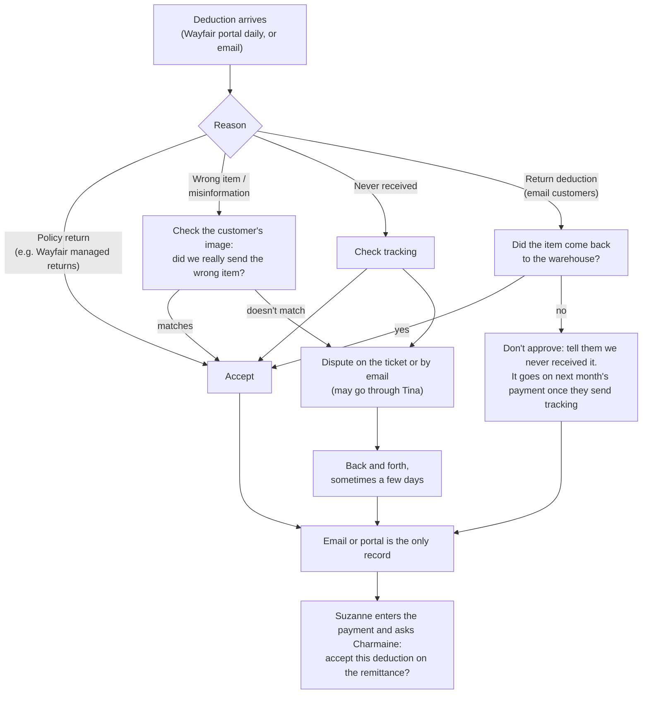

# Deductions and Disputes (Charmaine's DS customers)

> **In one line:** when a dropship customer takes money off a payment, Charmaine decides whether to accept or dispute it: policy returns are auto-accepted, the rest she checks against the customer's image, tracking or the warehouse. Her inbox and the portals are the only record, so Suzanne has to ask her about each remittance.

*From a conversation with Charmaine after Day 7, not watched, plus Day 2 (Part 7), where she was seen working Wayfair deductions. Suzanne's short pays, Baruch Salamander's SPS Commerce disputes (Home Depot, Walmart, Amazon, Lowes) and the Amazon dispute list from Avi G are related and will be added after those sessions.*

---

## At a Glance

| | |
| --- | --- |
| **What** | Accepting or disputing deductions that dropship customers take off their payments, and telling Suzanne which ones to accept on the remittance |
| **Scope** | Charmaine's customers, DS only: Wayfair, Lowes, OJCommerce and a few others in portals; VirVentures, UnbeatableSales and KartIt entirely by email |
| **Why** | So we don't lose money to deductions we shouldn't pay (wrong-item claims that don't match, returns that never came back), while accepting the ones our policies allow |
| **When** | Wayfair: every day, before each deduction's settlement date. UnbeatableSales: a batch of emails once a week. Others: as emails arrive |
| **Who** | Charmaine decides. Tina and Avi set the rules per customer, and Charmaine sometimes checks with Tina. Suzanne checks the amounts when she enters the payment |
| **Volume** | Oct 2 to 15: **70 deductions, 11 needed checking** (about 16%); the other 59 were auto-accepts. No running count is kept |
| **Time** | 5 to 10 minutes to gather the info for a dispute; about 5 to 15 minutes of her time per dispute. A dispute can stay open for a few days of back and forth |
| **Deadline** | Wayfair only: the settlement date on each deduction |
| **Systems** | Wayfair portal (tickets, CSV download), other customer portals, Outlook, carrier tracking, customer images, warehouse returns, F&O (Suzanne, at payment entry) |

### Customers

| Customer | Where deductions come in | Notes |
| --- | --- | --- |
| Wayfair | Portal, checked daily | Managed returns always accepted. Disputes on a ticket; Wayfair replies by email. Settlement date is the deadline |
| Lowes | Not stated | DS only (Baruch Salamander does Lowes on SPS Commerce, presumably the non-DS side) |
| OJCommerce | Not stated | DS |
| VirVentures | Email | Fully manual |
| UnbeatableSales | Email, a batch once a week | Each one checked for the return reaching the warehouse |
| KartIt | Email | Fully manual |

---

## The Flow

---

## Step by Step

| # | Who | Step | Where |
| --- | --- | --- | --- |
| 1 | Charmaine | Checks the Wayfair portal every day; reads deduction emails from VirVentures, UnbeatableSales and KartIt (Unbeatable's come as a weekly batch) | Wayfair portal, Outlook |
| 2 | Charmaine | Opens the deduction and reads the reason (on Wayfair, by clicking the PO number) | Portal, email |
| 3 | Charmaine | Policy reasons, like Wayfair managed returns, are accepted with no check | Portal, email |
| 4 | Charmaine | Wrong item or misinformation: compares the customer's image with what we sent | Portal, email |
| 5 | Charmaine | Never received: checks the carrier tracking | Tracking |
| 6 | Charmaine | Return deduction: confirms the item came back to the warehouse, as per our policy with that customer | Warehouse |
| 7 | Charmaine | Sometimes checks with Tina before answering | Teams, in person |
| 8 | Charmaine | Accepts, or disputes on the ticket (Wayfair) or by reply email. Wayfair answers by email, sometimes after a few rounds | Portal, email |
| 9 | Charmaine | Return not received: doesn't approve, tells them we never got it; it goes on next month's payment once they send tracking | Email |
| 10 | Charmaine | Saves the email (or leaves it in the portal) as the record | Outlook, portal |
| 11 | Suzanne | Enters the customer's payment in AR and checks the amounts | F&O |
| 12 | Suzanne → Charmaine | Asks, desk to desk, whether the remittance matches what Charmaine accepted. Charmaine searches her inbox or the portal | In person |
| 13 | Charmaine → Suzanne | Once a dispute is finished: won, don't accept that deduction on the remittance; lost, accept it. Nothing is passed on before then | In person |

---

## The Rules

> **Who owns the rules:** Tina and Avi set them for each customer. Charmaine knows them by heart but couldn't list them; nothing is written down.

| Reason | What she does |
| --- | --- |
| Wayfair managed returns | Always accept; it's our policy |
| Wrong item / mis-shipped / misinformation | Check the customer's image. Matches: accept. Doesn't match: dispute |
| Customer says it never arrived | Check tracking |
| Return deduction (email customers) | Accept only if the item came back to the warehouse, as per that customer's policy. Otherwise don't approve; it goes on next month's payment once they send tracking |
| Late receipt (Wayfair, seen on Day 2) | Accepted |

- **Deadline:** only Wayfair has one, the settlement date on each deduction.
- **Amounts:** Suzanne checks them when she enters the payment. Charmaine checks the reason, not the amount.
- **What Suzanne hears:** nothing until a dispute is finished. Won: don't accept the deduction on the remittance. Lost: accept it.

---

## Why It Works This Way

| Question | Answer |
| --- | --- |
| Why accept Wayfair returns without checking? | Managed returns are part of our policy with Wayfair |
| Why check wrong-item claims? | To make sure we actually sent the wrong item before paying for it |
| Why does Suzanne ask Charmaine? | The remittance shows deductions; only Charmaine knows which ones she accepted, and there's no list |
| Why does Charmaine check the reason but not the amount? | Suzanne checks the amount when she enters the payment. This explains Day 2's "method difference" between them |
| Why do some customers go by email? | VirVentures, UnbeatableSales and KartIt have no portal for this; it's all email |
| Why does a not-received return show up next month? | The deduction is refused until the customer sends tracking; then it's taken on the following payment |

---

## Pain Points

- **The rules are in Charmaine's head.** Tina and Avi set them per customer, Charmaine just does it and couldn't repeat them. If she's out, nobody else knows which reasons to accept.
- **Her inbox is the deductions log.** There's no list of what was accepted, disputed, won or lost. Every remittance means Suzanne asking and Charmaine searching email or a portal.
- **The hand-off only works because their desks are next to each other.** It's verbal, so nothing is recorded and it breaks if either one is out or moves.
- **No numbers.** No running count, no dollar total, no win rate. The 70-in-two-weeks figure was counted for this question.
- **Most of the work is no work.** About 84% are auto-accepts, but they still arrive mixed in with the 16% that need checking.
- **Evidence is gathered by hand,** 5 to 10 minutes each: the customer's image, tracking, whether the return reached the warehouse.
- **Open disputes aren't tracked.** A dispute can run a few days of ticket comments, and a refused return comes back next month once they send tracking. Nothing reminds anyone to follow up.
- **One deadline, watched by eye.** Wayfair's settlement dates are only in the portal.
- **UnbeatableSales sends a weekly pile of emails,** each opened and checked one at a time.
- **Same work, different places.** Charmaine (DS portals and email), Baruch Salamander (SPS Commerce) and Suzanne (short pays) each handle deductions their own way, with no shared view.

---

## My Ideas

*Drafted from the notes; edit or cut.*

1. **Write the rules down.** One table per customer: reason → accept, check or dispute, and what proof is needed. Tina and Avi sign off, and the bot uses the same table.
2. **One shared deductions log.** Customer, PO, invoice, amount, reason, decision, status (open, accepted, disputed, won, lost), settlement date, and a link to the email or ticket. Suzanne reads it when she enters a payment instead of asking. Even a shared spreadsheet or SharePoint list would do before any bot.
3. **Auto-log the auto-accepts.** The policy reasons (Wayfair managed returns) can go straight into the log as accepted, so Charmaine only sees the ones that need checking.
4. **Gather the proof for her.** For each deduction that needs a check, pull what we shipped from F&O, the tracking status and whether the return reached the warehouse, next to the customer's image.
5. **Watch the Wayfair settlement dates.** Flag anything still open a few days before its settlement date.
6. **Follow up on open items.** Remind her about disputes waiting on a reply, and check that refused returns actually come back on next month's payment.
7. **Turn Unbeatable's weekly emails into rows** in the log instead of opening them one by one.
8. **Get the numbers for free.** With a log, weekly counts, dollars and win rate per customer and reason come out of it. That's what tells us whether the rules are right.
9. **One deductions view for everyone.** Bring in Baruch Salamander's SPS Commerce disputes and Suzanne's short pays once those are shadowed, so all three work from the same log.
10. **Connect it to remittance matching (Bot D).** When Suzanne enters a payment, the matching bot reads the log and marks each deduction on the remittance as accept or don't accept.

---

## The Bot: Deductions Log and Checker (Bot I, proposed)

| | |
| --- | --- |
| **Trigger** | The daily Wayfair deductions CSV; any deduction email from VirVentures, UnbeatableSales, KartIt or the other DS customers; a remittance being entered by Suzanne |
| **What it does** | Adds every deduction to one log (customer, PO, invoice, amount, reason, settlement date, link to the email or ticket). Applies the written rules: policy reasons like Wayfair managed returns are marked accepted; wrong-item, never-received and return deductions go to Charmaine with the evidence already gathered (what we shipped from F&O, carrier tracking, whether the return reached the warehouse, the customer's image). Splits UnbeatableSales' weekly batch into one row each. Flags Wayfair deductions near their settlement date, disputes waiting on a reply, and refused returns that should come back on next month's payment. When Suzanne enters a payment, shows her which deductions on the remittance to accept and which not to |
| **Data** | Wayfair portal (CSV), deduction emails, F&O sales orders, invoices and shipments, carrier tracking, warehouse return receipts, the per-customer rules table |
| **First step** | Write the rules table with Tina and Avi, and start a shared deductions log, even by hand, so Suzanne can check it instead of asking |
| **Human check** | Charmaine decides every deduction that needs a check and writes the disputes; Suzanne still checks the amounts at payment entry |
| **Replaces** | Searching her inbox and portals each time Suzanne asks; gathering the evidence by hand; tracking deadlines and open disputes from memory. Around 5 to 6 checked deductions a week at 5 to 15 minutes each, plus every lookup for Suzanne |
| **Later** | Draft dispute replies from the evidence; bring in Baruch Salamander's SPS Commerce disputes and Suzanne's short pays; feed Bot D's remittance matching and Bot E's recovery reports |

---

*Sources: "Follow-up with Charmaine" in [raw_notes.md](../raw_notes.md) and [shadowing_notes.md](../shadowing_notes.md); Part 7 (Day 2 afternoon) in the [v2 report](../Shadowing_Report_2026-10-22_v2.md). Related: Suzanne's deductions and short pays (Part 2, Day 1 afternoon) and Baruch Salamander's SPS Commerce disputes (Part 11, Day 5).*
